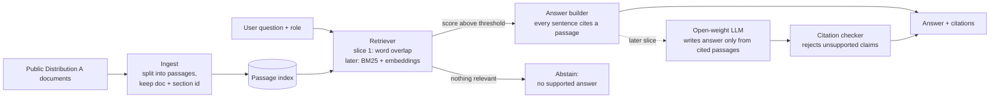

# Architecture: first vertical slice

The simplest complete version: split a few public documents into passages, retrieve by word overlap, and return the best passages with citations, or abstain if nothing matches. No language model yet; this is the grounding layer every later answer must pass through.

## Layers after slice 1

1. BM25 retrieval, then a local embedding model, compared on a small question set.
2. An open-weight model, run locally, that may only write from retrieved passages.
3. A citation checker that rejects any answer sentence not supported by its cited passage.
4. Evaluation harness: hallucination rate and citation accuracy versus a plain baseline model, as the Q&A requires.
5. Role adaptation (new sailor versus instructor) and xAPI statements for training systems.

## Design decisions

### 1. Retrieval with citations before any model

- **Constraint:** source-traceable answers are the minimum explainability requirement, and hallucination must be measured against a baseline.
- **Reasoning:** if the system cannot find and cite the right passage, no model on top can be trusted; building retrieval first gives a measurable floor.
- **Rejected alternative:** fine-tune a model on the corpus first. It can sound fluent but cannot show where an answer came from.
- **What breaks otherwise:** answers with no provenance, which is the failure the topic names.

### 2. Abstain when unsupported

- **Constraint:** hallucination reduction on organization-specific content.
- **Reasoning:** a training tool that says "no source found" is safer than one that invents a procedure; abstention rate becomes a tracked metric.
- **Rejected alternative:** always answer and attach a confidence score. Users tend to ignore scores.
- **What breaks otherwise:** confident wrong procedures in a training context.

### 3. Open-weight model run locally

- **Constraint:** the Q&A favors open-weight models and names on-premises and disconnected hosting.
- **Reasoning:** a local model can move to disconnected networks later without redesign.
- **Rejected alternative:** a hosted commercial API. Fastest for a demo, but it fails the disconnected case and sends data outside.
- **What breaks otherwise:** a Phase I demo that cannot transition.

### 4. Only Distribution A data in this repository

- **Constraint:** the Q&A says no CUI in Phase I, and this repository is public.
- **Reasoning:** keeping only public documents and synthetic learner data here keeps the repository safe to share.
- **Rejected alternative:** a private repository holding all candidate documents. Fine later for Phase II, not needed now.
- **What breaks otherwise:** a public repository exposes material it should not.
